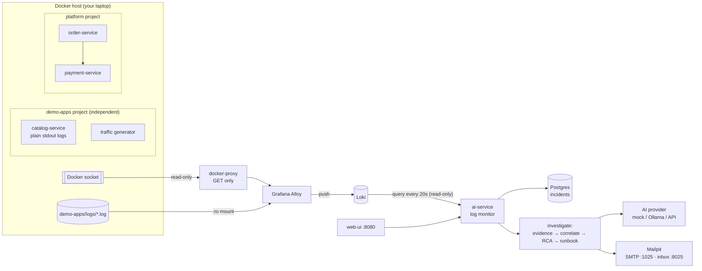

# Local POC guide: AI log monitoring and incident reports

This runs the whole product on one machine:

1. Collect logs, **read-only**, from our own services *and* from applications
   that know nothing about us.
2. Detect errors and recurring failure patterns.
3. Run AI root-cause analysis.
4. Email an incident report to a **free local test inbox**.

No paid service is needed; the AI model is optional.

Everything here is in the repository and was run end to end with
`scripts/poc_demo.py` (see [section 7](#7-validate-end-to-end)).

---

## 1. What the demo shows

| Capability | How it's shown |
|---|---|
| Monitor an **independent** application, no code changes | `demo-apps/catalog-service`: plain Node.js, separate compose project and network, no SDK |
| Monitor an app that writes **log files** | anything appended to `demo-apps/logs/*.log` |
| Monitor **our own** microservices | order-service, payment-service, ai-service, web-ui container logs |
| Read-only, non-intrusive collection | Alloy reads container logs through a Docker API proxy that only allows `GET`; log folders are mounted `:ro` |
| Error and anomaly detection | error-pattern templates; **new** pattern or **spike** vs that pattern's recent rate |
| Error classification | database, payment, timeout, http_5xx, auth, resource, dependency, crash |
| Recurring failures | same service + error type seen again within 7 days → flagged in title and email |
| AI RCA + remediation | existing pipeline: live evidence → correlation → RCA → runbook |
| Email to the support team | Mailpit (free, local) inbox at http://localhost:8025: *New incident* → *Incident report* → *Resolved*, threaded |
| Auto-resolve | no matching errors for `LOG_MONITOR_RESOLVE_AFTER_SECONDS` |

---

## 2. Technology stack

All of it is free and runs in Docker.

| Layer | Choice | Why |
|---|---|---|
| Log collection | **Grafana Alloy** `v1.5.1` | Discovers Docker containers, tails files; widely used and supported |
| Read-only Docker access | **docker-socket-proxy** `0.3.0` (`CONTAINERS=1`, `NETWORKS=1`, `POST=0`) | Alloy never gets the raw Docker socket, so it can't start, stop or exec |
| Log store | **Loki** `3.2.1` | Label-based, cheap; queried by the log monitor |
| Detection + AI + API | **ai-service** (Python 3.12, FastAPI) | Log monitor, incidents, correlation, RCA, runbook, email |
| Incident database | **PostgreSQL 16** (Alembic migrations) | Incidents, evidence, history for recurrence |
| AI model | **mock** (default, no key) · **Ollama** (free, local) · Gemini / Claude / OpenAI (API key) | Switch with one setting |
| Email | **Mailpit** `v1.21.8` | Free SMTP test server with web inbox and REST API; nothing leaves the machine |
| UI / dashboards | web-ui (nginx) · Grafana | Incidents in the browser; logs and metrics in Grafana |
| Metrics / traces (optional) | OTel Collector, Prometheus, Alertmanager, Tempo | Extra evidence; alert-driven incidents |

---

## 3. Architecture



**Step by step:**
1. **Apps log as usual.** Docker stores container stdout; legacy apps write files.
2. **Alloy collects the logs.** It discovers every container through the GET-only
   proxy and tails each one's logs. It adds `service_name` (the compose
   service or container name), `compose_project` and `source=docker`. For
   files, it sets `source=file` and uses the file name as `service_name`. It
   skips its own infrastructure: loki, prometheus, grafana, alloy, postgres,
   mailpit and so on.
3. **The log monitor polls Loki** every `LOG_MONITOR_INTERVAL_SECONDS` (20 s in
   compose). Code: `services/ai-service/app/services/log_monitor.py`. Each
   poll:
   - reads new lines since its cursor
   - keeps failures: ERROR/FATAL lines, HTTP 5xx access lines, and WARN lines
     with failure words
   - strips timestamps, IDs and numbers to get a **pattern**, and classifies it
   - flags a pattern that is **new** (≥ 2 hits, or 1 if FATAL) or **spiking**
     against its own recent per-poll counts (robust z-score ≥ 3)
4. **Grouping:** one open incident per *service + error type*. HTTP 5xx lines
   are symptoms and join the cause's incident (for example "Database
   errors"). Further errors update the open incident instead of opening a new
   one.
5. **Investigation**, reusing the existing pipeline:
   1. pull more evidence from Loki, Prometheus and Tempo
   2. baseline check, then correlation and severity score
   3. **AI root cause**, informed by similar past incidents
   4. **AI runbook**
6. **Emails** (`app/services/email_report.py`), one thread per incident:
   - **New incident:** summary, error type, first error, impact.
   - **Incident report:** severity, potential impact, probable root cause with
     confidence and alternatives, suggested resolution steps with commands,
     remediation actions with risk, verification checks, key evidence lines,
     and a link to the UI. Log text is HTML-escaped and redacted (card
     numbers, tokens, secrets, email addresses).
   - **Resolved:** sent after the quiet period, with the duration.

---

## 4. Project structure (POC-relevant parts)

```
├── docker-compose.yml               platform: ai-service, Loki, Alloy, docker-proxy, Mailpit, Postgres, UI, ...
├── observability/
│   └── alloy/config.alloy           read-only collection: containers + *.log files → Loki
├── demo-apps/                       "someone else's" apps — separate compose project
│   ├── docker-compose.yml           catalog-service + traffic generator
│   ├── catalog-service/server.js    Node.js, no deps, chaos switch: POST /chaos?mode=...
│   └── logs/                        drop *.log files here (tailed read-only)
├── services/ai-service/app/
│   ├── services/log_monitor.py      detection: parse → pattern → new/spike → incident
│   ├── services/email_report.py     report content + SMTP sender (+ redaction)
│   ├── services/notifier.py         routes events to email / Slack / webhooks
│   ├── services/alert_ingest.py     investigate(): enrich → correlate → RCA → runbook
│   ├── api/v1/endpoints/log_monitor.py   GET /log-monitor/status, POST /log-monitor/run
│   └── ...                          incidents, RCA, runbook, providers, store (unchanged)
├── services/web-ui/                 incident UI on :8080
└── scripts/poc_demo.py              end-to-end validation (stdlib Python)
```

**Modular by design:**
- **Collector:** the detector reads Loki only, through one LogQL selector
  (`LOG_MONITOR_QUERY`), so swapping Alloy for any Loki-compatible shipper
  needs no code change.
- **AI model:** chosen with `AI_PROVIDER`.
- **Notification channels:** email, Slack and webhooks are independent.

---

## 5. Setup

**Prerequisites:**
- Docker Desktop (or Docker Engine + Compose v2), about 6 GB free RAM
- Git
- Python 3.10+ (only for the validation script)
- Optional: Node 20 (only to run the UI's unit tests)

```bash
git clone <repo> && cd AIIncidentIntelligence-main
git checkout enhancements/ai-platform

# one-time: env files from the templates
cp services/ai-service/.env.example      services/ai-service/.env
cp services/order-service/.env.example   services/order-service/.env
cp services/payment-service/.env.example services/payment-service/.env

# 1. the platform (first build takes a few minutes)
docker compose up -d --build

# 2. the independent demo apps (separate project, separate network)
docker compose -f demo-apps/docker-compose.yml up -d --build

# 3. check
docker compose ps
curl http://localhost:8000/api/v1/health/ready          # {"status":"ready",...,"database":"postgres"}
curl http://localhost:8000/api/v1/log-monitor/status     # "running": true
```

`docker-compose.yml` enables the log monitor and email for the POC
(`LOG_MONITOR_ENABLED=true`, `SMTP_HOST=mailpit`,
`NOTIFY_EMAIL_TO=["prod-support@demo.local"]`). You don't need to edit `.env`.

| Open | URL |
|---|---|
| **Test inbox (Mailpit)** | http://localhost:8025 |
| **Incident UI** | http://localhost:8080 |
| API docs | http://localhost:8000/docs |
| Grafana (logs: Explore → Loki → `{source="docker"}`) | http://localhost:3000 (admin/admin) |
| Alloy pipeline status | http://localhost:12345 |
| catalog-service (demo app) | http://localhost:8090/products |

### Choosing the AI model

| Option | Cost | Set (in `services/ai-service/.env`, then `docker compose up -d ai-service`) |
|---|---|---|
| mock (default) | free, no setup | `AI_PROVIDER=mock`. Keyword-based placeholder RCA; reports are clearly labelled "placeholder" |
| Ollama (local model) | free | Run Ollama on the host, `ollama pull llama3.1`, then `AI_PROVIDER=ollama`, `OLLAMA_BASE_URL=http://host.docker.internal:11434/v1` |
| Gemini / Claude / OpenAI | API pricing (Gemini has a free tier) | `AI_PROVIDER=gemini` + `GEMINI_API_KEY=…`, or `anthropic` + `ANTHROPIC_API_KEY`, or `openai` + `OPENAI_API_KEY` |

The POC was validated with the mock provider. Real-model output quality can be
measured with `python -m evals.run_evals` (in `services/ai-service`).

---

## 6. Run the demo by hand

```bash
# break the independent app's "database"
curl -X POST "http://localhost:8090/chaos?mode=db_down"
#   ~20–40 s later: Mailpit shows "New incident: [Logs] catalog-service: Database errors"
#   a few seconds later (mock AI) or ~1 min (real AI): "Incident report: ..."

# watch the detector
curl http://localhost:8000/api/v1/log-monitor/status     # counters + top error patterns

# simulate a legacy app writing a log file
echo "[$(date -u '+%Y-%m-%d %H:%M:%S,000')] ERROR Payment gateway rejected batch charge (invoice INV-1)" >> demo-apps/logs/legacy-billing.log
echo "[$(date -u '+%Y-%m-%d %H:%M:%S,000')] ERROR Payment gateway rejected batch charge (invoice INV-2)" >> demo-apps/logs/legacy-billing.log

# fail our own payment-service and send orders
curl -X PUT http://localhost:8002/api/v1/fault-injection -H "Content-Type: application/json" -d '{"failure_rate":1.0,"latency_ms":0}'
for i in 1 2 3 4 5; do curl -s -X POST http://localhost:8001/api/v1/orders -H "Content-Type: application/json" \
  -d '{"customer_id":"c1","items":[{"sku":"S","name":"W","quantity":1,"unit_price":5}]}' > /dev/null; done
curl -X DELETE http://localhost:8002/api/v1/fault-injection

# recover: after LOG_MONITOR_RESOLVE_AFTER_SECONDS (180 s in compose) of no errors -> "Resolved" email
curl -X POST "http://localhost:8090/chaos?mode=ok"

# break it again -> new incident titled "... (recurring: 2x in 7 days)"
curl -X POST "http://localhost:8090/chaos?mode=db_down"
```

Other chaos modes: `timeout` (DB query timeouts) and `payment_errors`
(gateway rejections, HTTP 502).

**Testing tip:** `POST /api/v1/log-monitor/run?wait=true` runs a poll
immediately instead of waiting for the next interval.

---

## 7. Validate end to end

```bash
python scripts/poc_demo.py           # all scenarios incl. auto-resolve + recurrence (~6–7 min)
python scripts/poc_demo.py --quick   # detection + report emails only (~2 min)
```

The script checks preflight (all services up, monitor running), then runs
five scenarios. Each one checks the Mailpit inbox through its API:

1. **catalog-service DB down** (independent app, stdout): *New incident* and
   *Incident report* emails arrive; the report has root cause, resolution,
   impact and evidence sections; the 5xx symptoms are merged into one
   incident.
2. **legacy-billing.log** (independent app, file): an incident email arrives.
3. **payment-service failures** (our own project): an incident email arrives.
4. **Recovery:** a *Resolved* email arrives after the quiet period.
5. **Recurrence:** the new incident is flagged "recurring".

It exits with 0 when every check passes and prints the report's plain-text
part.

**Unit and integration tests** (no Docker needed):

```bash
cd services/ai-service
pip install -r requirements-dev.txt
pytest -q          # includes tests/test_log_monitor.py and tests/test_email_report.py
```

---

## 8. Integrate another application

Nothing changes in the application. Pick whichever matches how it runs:

| The app runs… | Do this |
|---|---|
| as a Docker container on this host (any project, any network) | Nothing; Alloy discovers it within ~10 s. `service_name` = compose service name, or the container name |
| as a process writing log files | Mount or copy its log directory into `demo-apps/logs/` (or add a path to `local.file_match` in `config.alloy`); file name = service name |
| anywhere else, with an existing log shipper (Fluent Bit, Vector, Promtail, OTel) | Point the shipper at Loki `http://<host>:3100/loki/api/v1/push` with labels `source="docker"` (or `"file"`) and `service_name="<app>"` |

**Scope controls (optional):**
- Watch only some compose projects: `LOGMON_WATCH_PROJECTS="demo-apps|myapp" docker compose up -d alloy`
- Skip a container: give it the label `logmon.ignore=true`
- Skip a service in detection: `LOG_MONITOR_EXCLUDE_SERVICES=["noisy-svc"]`

**Better logs mean better RCA.** One line per event, a level word (or JSON
with `level`/`message`), and a request or trace ID. JSON logs are parsed
(`level`/`levelname`/`severity`, `message`/`msg`, `trace_id`, `exception`).

**Detection tuning** (ai-service settings):

| Setting | Default (compose) | Meaning |
|---|---|---|
| `LOG_MONITOR_INTERVAL_SECONDS` | 30 (20) | poll period |
| `LOG_MONITOR_NEW_PATTERN_MIN_COUNT` | 2 | hits per poll for a never-seen error pattern |
| `LOG_MONITOR_MIN_COUNT` / `LOG_MONITOR_Z_THRESHOLD` | 3 / 3.0 | a known pattern must reach this count *and* spike |
| `LOG_MONITOR_RESOLVE_AFTER_SECONDS` | 300 (180) | quiet time before auto-resolve |
| `LOG_MONITOR_RECURRING_DAYS` | 7 | look-back for the "recurring" flag |
| `NOTIFY_EMAIL_TO` / `NOTIFY_EMAIL_EVENTS` | support inbox / created, report, resolved | who gets which emails |
| `NOTIFY_MIN_SEVERITY` | WARN | minimum incident severity that is notified |

**Moving to a real mail server later:** set `SMTP_HOST`, `SMTP_PORT=587`,
`SMTP_STARTTLS=true`, `SMTP_USERNAME`, `SMTP_PASSWORD`, `NOTIFY_EMAIL_FROM`.
No code change.

---

## 9. Security notes

- **Read-only access:**
  - The Docker socket is only reachable through docker-proxy, which rejects
    every non-GET request.
  - `:ro` on the socket mount alone would *not* be enough: the Docker API
    allows writes over a read-only socket file, and the proxy is what blocks
    them.
  - Log folders are mounted `:ro`.
  - The log monitor only *queries* Loki.
- **Redaction applies to emails only for now:** card numbers, JWTs, bearer
  tokens, `password=`/`token=`-style secrets and email addresses are removed
  from email content. Logs stored in Loki, and the evidence sent to the AI
  model, are **not** redacted yet (see gaps).
- **The POC has no authentication** (`ENABLE_AUTH=false`). Don't expose its
  ports beyond your machine. API-key auth already exists; see the ai-service
  README.

---

## 10. Troubleshooting

| Symptom | Check |
|---|---|
| No incidents | `GET /api/v1/log-monitor/status` → `running`, `lines_scanned`, `last_error`; Grafana Explore → Loki → `{source="docker"}` shows your app's lines? |
| App's logs not in Loki | http://localhost:12345 (Alloy UI) → `discovery.docker` / `loki.source.docker` health; `docker compose logs alloy`; is the container labelled `logmon.ignore`, or outside `LOGMON_WATCH_PROJECTS`? |
| Alloy logs `403 Forbidden` | docker-proxy blocks an endpoint Alloy needs; compose already allows `CONTAINERS` and `NETWORKS` |
| Alloy logs `timestamp too old` once at startup | harmless: Loki rejects history older than 7 days when Alloy first reads an old container |
| No emails | `docker compose logs ai-service | grep -i email`; `/metrics` → `ai_notifications_total{target="email"}`; incident severity ≥ `NOTIFY_MIN_SEVERITY`? |
| Errors keep updating one old incident | intended while it's open; it resolves after the quiet period, or `PATCH /incidents/{id}/status?new_status=RESOLVED` |
| Reports say "placeholder" | `AI_PROVIDER=mock`; choose a real model (section 5) |
| Port already in use | change the left side of the port mapping in the compose file, e.g. `"18025:8025"` |

Stop everything: `docker compose -f demo-apps/docker-compose.yml down && docker compose down`
(add `-v` to delete stored data).

---

## 11. POC limitations (before production)

- **Single host, single tenant.** No multi-tenancy, client onboarding or
  billing.
- **Pattern history is in memory.** After an ai-service restart, the
  first-seen and spike history is relearned. Incidents and recurrence are
  stored.
- **Background work is in-process.** No queue; a restart during an
  investigation loses that run.
- **Polling delay:** detection runs about 20–40 s behind the logs.
- **Partial redaction.** Logs and AI prompts aren't redacted yet, only email
  content.
- **Pattern grouping is simple.** It's rule-based (strip IDs and numbers,
  first 10 words), not a full log-clustering algorithm such as Drain.
- **Kubernetes:** the same Alloy config pattern applies to a Kubernetes
  DaemonSet, but this POC runs on Docker only.
