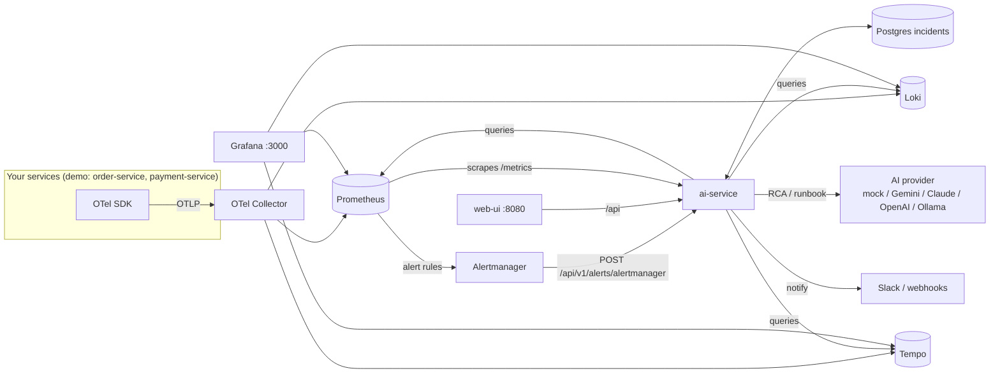
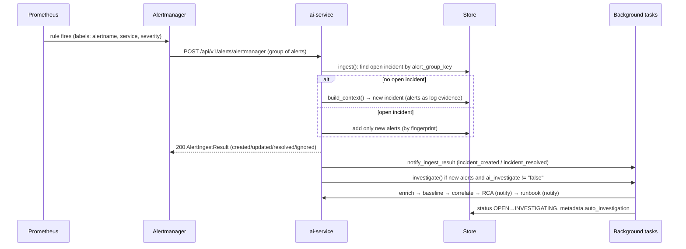

# System flow: start → detect → analyze → notify → resolve

This document describes what the code in this repository actually does, end to
end. Paths, settings and function names are the real ones. Anything that is
planned but not built is marked **Not in this codebase**.

Audience: engineers joining the project, and platform teams evaluating it.

---

## 1. Big picture

Your services send logs, metrics and traces through an OpenTelemetry Collector
into Prometheus, Loki and Tempo. Prometheus alert rules fire into
Alertmanager, which posts to **ai-service**. ai-service turns each alert group
into one **incident** and, in the background, investigates it:

1. pulls live evidence for the affected services
2. compares them with their own recent history
3. correlates the evidence and scores severity (rules)
4. asks an AI model for a root cause and a runbook

Results are stored on the incident and announced on Slack or webhooks. When
Alertmanager reports the alert as resolved, or a person marks it resolved, the
incident is closed out and that is announced too. People work with incidents
in the **web UI**, the REST API, and Grafana.



---

## 2. Component glossary

| Component | What it is | Why it exists | Called by | Outputs | Main files / endpoints |
|---|---|---|---|---|---|
| **ai-service** | FastAPI app; the product | Owns incidents and every analysis step | Alertmanager, web UI, people/scripts, Prometheus (scrape) | REST responses, stored incidents, notifications, `/metrics` | `services/ai-service/app/main.py`, `app/api/v1/router.py` |
| **Incident store** | Persistence for incidents | One place every writer goes through, safe under concurrency | All ai-service paths | `IncidentContext` objects | `app/services/incident_store.py`; Postgres when `DATABASE_URL` is set, otherwise in-memory |
| **Database migrations** | Alembic schema management | Upgrade the schema on deploy without data loss | `init_db()` at startup | `incidents`, `incident_evidence` tables | `app/db/migrate.py`, `app/db/migrations/versions/0001–0003` |
| **Alert ingest** | Alertmanager webhook handler | Turn alerts into incidents without app changes | Alertmanager | `AlertIngestResult`; incident created/updated/resolved | `POST /api/v1/alerts/alertmanager` → `app/services/alert_ingest.py` (`ingest_and_plan`, `investigate`) |
| **Context builder** | Builds or extends an incident from evidence | Single way evidence becomes an incident (dedupes evidence) | Manual API, alert ingest, scenarios, enrichment, e2e | `IncidentContext` | `app/services/context_builder.py` (`build_context`) |
| **Telemetry enrichment** | Pulls live logs/metrics/spans for the incident's services and window | Incidents from alerts start with almost no evidence | Auto-investigation, API, agent tool | `EnrichmentResult` (counts per source); evidence merged into incident | `POST /incidents/{id}/enrich` → `app/services/telemetry_enrichment.py` |
| **Baseline analysis** | Compares each service with its last hour in Prometheus (robust z-score) | Fixed thresholds miss "abnormal for this service" | Auto-investigation, API, agent tool | `BaselineResult`; stored as `metadata.baseline` | `POST /incidents/{id}/baseline` → `app/services/baseline.py` |
| **Correlation** | Links evidence, detects anomalies, scores severity 0–100 | Gives RCA structured, ranked signals; raises severity | Auto-investigation, API, RCA (by default), agent, e2e | `CorrelationResult`; updates severity + metadata | `POST /incidents/{id}/correlate` → `app/services/correlation.py` (`correlate_incident`) |
| **Similar incidents** | Signature-based search over past incidents | Lets RCA and people see how similar incidents went | RCA engine, API, agent tool, web UI | `SimilarIncident` list | `GET /incidents/{id}/similar` → `app/services/similarity.py`, `incident_store.find_similar` |
| **RCA engine** | AI root-cause analysis | Explain *why* from the evidence | Auto-investigation, API, agent, e2e | `RCAResponse` (cause, hypotheses, confidence, `usage`, `similar_incidents`) | `POST /incidents/{id}/rca` → `app/services/rca_engine.py`, prompt `app/prompts/rca.py` (`rca_v2`) |
| **Runbook engine** | AI runbook + remediation | Tell on-call *what to do* | Auto-investigation, API, agent, e2e | `RunbookResponse` (steps, remediation, checks, escalation) | `POST /incidents/{id}/runbook` → `app/services/runbook_engine.py`, prompt `runbook_v1` |
| **AI provider layer** | Abstraction over models + retries, fallback, cache, cost metrics | Swap models without touching callers; survive outages | RCA, runbook, log analysis, agent planner | Validated Pydantic objects + `GenerationInfo` (provider, tokens, degraded) | `app/providers/` (`factory.get_ai_provider`, `ResilientAIProvider`, mock/gemini/anthropic/openai) |
| **Investigation agent** | Multi-step investigation over tools | Answer a question about an incident in one call | People, web UI | `AgentInvestigateResponse`, or a server-sent event stream | `POST /api/v1/agent/investigate`, `/investigate/stream` → `app/agent/` |
| **Log analysis** | One-shot AI triage of pasted log text | Quick, stateless triage | People | `LogAnalysisResponse` (not stored) | `POST /api/v1/logs/analyze` |
| **Notifier** | Slack and generic-webhook delivery | Tell people without them polling | Incident endpoints, alert ingest/investigation | Slack Block Kit message / JSON POST | `app/services/notifier.py` |
| **Auth + rate limit** | API keys with scopes; per-client token buckets | Protect the API and AI spend | Every request (middleware) | 401 / 403 / 429 / 503 | `app/core/auth.py`, `app/core/rate_limit.py` |
| **E2E endpoint** | Synthetic self-test of the pipeline | Smoke-test a deployment | People, `scripts/validate_mvp.sh` | `E2EResponse` (step results) | `POST /api/v1/e2e/run` |
| **Web UI** | Static app behind nginx | Day-to-day view of incidents | Browsers | HTML; proxies `/api` to ai-service | `services/web-ui/`, http://localhost:8080 |
| **Observability stack** | OTel Collector, Prometheus, Alertmanager, Loki, Tempo, Grafana | Collect telemetry, alert, visualise | Apps (OTLP), ai-service (queries) | Series, logs, traces, alerts, dashboards | `observability/`, `docker-compose.yml` |
| **order-service / payment-service** | Sample microservices | **Optional demo traffic** and failure injection; not needed by clients | People, scenario runner | Orders/payments + telemetry | `services/order-service`, `services/payment-service` (`/api/v1/fault-injection`) |

---

## 3. Startup sequence (flow A)

`docker compose up -d --build` starts 11 containers: postgres, otel-collector,
prometheus, alertmanager, loki, tempo, grafana, payment-service,
order-service, ai-service, web-ui. ai-service waits for Postgres to be healthy
(`depends_on: condition: service_healthy`).

Inside ai-service (`uvicorn app.main:app`):

1. **Settings load**: `app/core/config.py` `get_settings()` reads environment
   variables, then `.env` (environment variables win). Compose sets
   `DATABASE_URL`, `PROMETHEUS_URL`, `LOKI_URL`, `TEMPO_URL`,
   `OTEL_EXPORTER_OTLP_ENDPOINT`, `LOG_FORMAT=json`.
2. **App built**: `create_app()` configures logging (`configure_logging`), then
   adds middleware (outermost first: request ID → CORS → API-key auth →
   rate limit) and mounts routers under `/api/v1` plus `/metrics`.
3. **Lifespan startup** (`_make_lifespan`):
   1. `setup_telemetry()`: OTLP export of traces, metrics and logs (skipped if
      `OTEL_EXPORTER_OTLP_ENDPOINT` is empty), then `instrument_app()`.
   2. `init_db()`: if `DATABASE_URL` is set, `upgrade_to_head()` runs Alembic
      migrations (stamping pre-migration databases at `0001` first; a
      Postgres advisory lock stops concurrent replicas migrating twice). If
      unset, the in-memory store is used. **A failure here stops the
      service.**
   3. Logs `Starting ai-service …`, and warns if
      `ENVIRONMENT=production` with `ENABLE_AUTH=false`.
4. **Ready**: `GET /api/v1/health` (liveness, no dependencies) and
   `GET /api/v1/health/ready` (runs `SELECT 1` against Postgres; reports
   `ai_provider` and `database: postgres|memory|error`).
5. **Lazy on first use**: the AI provider chain (`get_ai_provider()`, cached),
   the shared HTTP client for Prometheus, Loki and Tempo, and the DB engine.

```
docker compose up
  └─ postgres healthy ──► ai-service: settings → create_app → middleware/routers
                                     → lifespan: telemetry → init_db (migrations)
                                     → /health/ready = ready
```

---

## 4. Entry points

Every route below is under `/api/v1` unless noted. The **Scope** column applies
when `ENABLE_AUTH=true`.

| Method + path | Who uses it | Scope | Notifies? |
|---|---|---|---|
| `POST /alerts/alertmanager` | Alertmanager | `alerts` | created / resolved, plus RCA and runbook from the background investigation |
| `POST /incidents` | People, UI | `write` | `incident_created` |
| `POST /incidents/context` | People, scripts (push your own evidence) | `write` | `incident_created` (new incidents only) |
| `POST /incidents/scenarios/run` | Demo, UI | `write` | `incident_created` |
| `GET /incidents`, `/incidents/summaries`, `/incidents/{id}` | UI, people | `read` | — |
| `POST /incidents/{id}/enrich` | UI, people | `write` | — |
| `POST /incidents/{id}/baseline` | UI, people | `write` | — |
| `POST /incidents/{id}/correlate` | UI, people | `write` | — |
| `GET /incidents/{id}/similar` | UI, people | `read` | — |
| `POST /incidents/{id}/rca` | UI, people | `ai` | `rca_completed` |
| `POST /incidents/{id}/runbook` | UI, people | `ai` | `runbook_completed` |
| `PATCH /incidents/{id}/status?new_status=…` | UI, people | `write` | `incident_resolved` (only on a change to `RESOLVED`) |
| `POST /agent/investigate`, `/agent/investigate/stream` | UI, people | `ai` | **No** (the agent's RCA/runbook calls do not notify) |
| `POST /logs/analyze` | People | `ai` | No (not stored) |
| `POST /e2e/run` | Smoke tests | `ai` | No |
| `GET /observability/{health,metrics,logs,traces,traces/{id}}` | People | `read` | — |
| `POST /telemetry/{logs,metrics,traces}` | — | `write` | **Echo only**: validates and returns the payload, stores nothing |
| `GET /health`, `/health/ready`, `/metrics` (no prefix) | Probes, Prometheus | public | — |

**Log ingest (`/api/v1/ingest/logs`): Not in this codebase.** Logs reach the
system only through the OTel Collector into Loki, where enrichment reads them,
or inside a `POST /incidents/context` body. Nothing turns a stream of logs
into incidents by itself; detection is done by Prometheus alert rules.

---

## 5. Flows

### B. Demo traffic (optional, not needed by clients)

```
client ──POST /api/v1/orders──► order-service ──POST /api/v1/payments──► payment-service
             │  (W3C trace context propagated)              │ FAILURE_RATE / LATENCY_MS
             └──── OTLP traces, metrics, logs ──────────────┴──► otel-collector
                     ├─► Prometheus  (metrics renamed otel_*, e.g. otel_payments_total)
                     ├─► Loki        (JSON lines: body, severity, traceid)
                     └─► Tempo       (traces)                ──► Grafana dashboards
```

`payment-service` exposes `GET/PUT/DELETE /api/v1/fault-injection` to change
`failure_rate` and `latency_ms` at runtime. It is disabled when
`ENVIRONMENT=production` unless `FAULT_INJECTION_API_ENABLED=true`.
`POST /incidents/scenarios/run` uses it: it applies a scenario, sends N
orders, restores the previous settings, and opens an incident built from
**synthetic** telemetry describing the outcome.

### C1. Alert path: Implemented



Step by step (`app/services/alert_ingest.py`):

1. Alertmanager groups alerts by `alertname` and `service`
   (`observability/alertmanager.yml`: `group_wait 30s`, `group_interval 5m`,
   `repeat_interval 4h`, `send_resolved: true`) and posts the group.
2. `ingest()` looks up an **open** incident whose `metadata.alert_group_key`
   equals the group's `groupKey` (`incident_store.find_open_by_metadata`).
3. **Firing, no open incident** → `build_context()` creates one:
   - title `"[Alert] <commonAnnotations.summary>"`, or the alert names
   - severity: the worst alert's `severity` label (`critical|page`→FATAL,
     `error|high`→ERROR, `warning|warn`→WARN, `info`→INFO, otherwise WARN)
   - services from the labels `service`, then `service_name`, then `job`
   - time window from the earliest `startsAt` to now
   - each alert stored as a log record `"ALERT <name> firing: <summary> — <description>"`
4. **Firing, open incident exists** → only alerts whose fingerprint isn't in
   `metadata.alert_fingerprints` are added. Alertmanager's periodic repeats
   add nothing and **do not** re-trigger investigation.
5. Metadata is tagged: `source=alertmanager`, `alert_group_key`, `alertnames`,
   `alert_fingerprints`, `alertmanager_url`.
6. The webhook answers immediately. Background tasks run in order:
   `notify_ingest_result`, then `investigate()` if `investigation_scheduled`
   (new alerts, at least one without `ai_investigate="false"`, and
   `ALERT_AUTO_INVESTIGATE=true`).

The AI-service's own alerts (`AIProviderFallbackActive`,
`AIProviderErrorRateHigh`) carry `ai_investigate: "false"`, so an AI outage
opens an incident without spending more AI calls.

### C2. Log path: Not in this codebase

There is no log-ingest endpoint and no log-pattern detector. Logs are used as
evidence, through enrichment from Loki or evidence pushed via
`POST /incidents/context`, but they never create incidents on their own.

### C3. Manual API / UI path: Implemented

A person (web UI, Postman, curl) creates an incident with `POST /incidents`,
`POST /incidents/context` (with their own logs, metrics and spans), or a
scenario. They then run any step in any order: `enrich`, `baseline`,
`correlate`, `rca`, `runbook`, `similar`, or the agent. Each step stores its
result on the incident. Only create, RCA, runbook and resolve send
notifications (see the table in section 4).

### D. Investigation pipeline (shared)

Used in full by `alert_ingest.investigate()`. Each step can be run separately
from the API or UI.

```
load incident
  → enrich     (ALERT_AUTO_ENRICH)   Loki/Prometheus/Tempo → new evidence (deduplicated)
  → baseline   (BASELINE_ENABLED)    Prometheus history   → metadata.baseline
  → correlate  (always)              rules                → severity, anomalies, metadata
  → RCA        (ALERT_AUTO_RCA)      AI + similar incidents → metadata.rca_*, note line  → notify rca_completed
  → runbook    (ALERT_AUTO_RUNBOOK)  AI + prior RCA        → metadata.runbook_*          → notify runbook_completed
  → status OPEN → INVESTIGATING; metadata.auto_investigation = {finished_at, steps: {name: "ok" | "error: …"}}
```

- **A failing step doesn't stop the pipeline**: it's recorded as
  `"error: …"` and the next step runs.
- **Enrichment** queries per service over the incident window
  (`ENRICH_LOOKBACK_SECONDS`): Loki logs (JSON lines parsed for severity and
  trace ID), Prometheus series (`otel_` prefix stripped; histogram sum/count
  turned into averages), Tempo traces (expanded to spans). A backend being
  down shows in `sources`, not as a failure.
- **Baseline** compares the incident window (at least 5 min) with the
  preceding `BASELINE_LOOKBACK_SECONDS` using median/MAD z-scores on
  `request_rate`, `http_error_ratio`, `latency_avg` and `failure_ratio`.
  Flagged signals become `baseline_<signal>` anomalies in correlation.
- **Correlation**: see section 7.
- **RCA** renders the `rca_v2` prompt: incident header, up to 20 logs, 15
  metrics and 20 spans, the correlation block, and up to `SIMILAR_IN_RCA`
  similar past incidents marked "context only, not evidence". It calls the
  provider for a structured `RCAResult`, then writes `rca_*` metadata and
  appends `[RCA] <summary>` to the notes. Previous `rca_*` metadata and
  `[RCA]` notes are kept **out** of the prompt, so the model isn't anchored
  on its last answer.
- **Runbook** renders `runbook_v1` with evidence plus the prior RCA. Output:
  ordered steps (with command, expected result, rollback), remediation
  actions (priority, risk, confidence), verification checks, escalation
  guidance, and estimated time.
- **Agent** (`app/agent/`): in `planner` mode the model picks one of 13 tools
  per step via structured output, up to `max_steps`. In `fixed` mode it runs
  get → search evidence → correlate → RCA → runbook. `AGENT_MODE=auto` uses
  the planner when a real model is configured and the fixed pipeline with the
  mock. The streaming variant sends `mode`, `planning`, `step`, `result` and
  `error` events.

### E. Resolution path: Implemented (two ways)

| Trigger | What happens | Notification |
|---|---|---|
| Alertmanager sends the group with `status: resolved` (or no firing alerts) | `ingest()` sets `RESOLVED` and appends `[alert] Resolved by Alertmanager at <time>` to the notes. A group with no open incident is `ignored`. | `incident_resolved` |
| `PATCH /incidents/{id}/status?new_status=RESOLVED` (UI "Resolve") | Sets the status | `incident_resolved`, only if it wasn't already RESOLVED or CLOSED |
| `PATCH …?new_status=CLOSED` / `OPEN` / `INVESTIGATING` | Sets the status ("Reopen" in the UI) | none |

- **Nothing sets `CLOSED` automatically.** It's a manual status only.
- **After resolve:** a later alert for the same group opens a **new**
  incident, because only open incidents (`OPEN`, `INVESTIGATING`) are matched.

---

## 6. Happy path walkthrough: "payment failures"

The alert, incident, investigation and resolve steps were exercised on the docker
compose stack (mock AI provider). The Slack and webhook content below comes from
`notifier.build_slack_message` / `build_payload`; it was tested against captured
requests, not a live Slack workspace.

1. **Payments start failing.** The demo injects this with
   `PUT /fault-injection {"failure_rate": 1.0}`. payment-service records
   `otel_payments_total{status="failed"}` and logs `Returning failed payment …`.
2. **Alert fires.** After 2 minutes above 30%, Prometheus fires
   `HighPaymentFailureRate` with labels `service=payment-service`,
   `severity=warning`.
3. **Alertmanager posts the group** (after `group_wait` 30 s).
4. **ai-service opens an incident:** "[Alert] High payment failure rate", WARN,
   `affected_services=["payment-service"]`, one alert log line. It responds
   `{"action": "created", "investigation_scheduled": true, …}`.
5. **Slack posts `New incident: [Alert] High payment failure rate`**:

   ```
   🟡 New incident: [Alert] High payment failure rate
   Severity: WARN   Status: OPEN   Services: payment-service   Incident: <id>
   Source: alertmanager
   ```
6. **Investigation:**
   1. enrich adds about 100 live logs, metrics and spans
   2. baseline flags `failure_ratio` (0 → 1.0)
   3. correlation finds `error_rate_spike` and `baseline_failure_ratio`, and
      raises severity (ERROR, score ~80)
   4. RCA and runbook run
7. **Slack: `Root cause analysis ready`**, with
   `Likely cause: <primary_cause> (confidence <x>)`. A
   "fallback provider … placeholder text" warning is added if the mock
   answered.
8. **Slack: `Runbook ready`**, with `Runbook: <title> — <n> steps`.
9. **The incident is now `INVESTIGATING`.** The web UI shows evidence, the
   baseline table, anomalies, root cause, runbook, similar past incidents,
   and the automatic-investigation step list.
10. **Recovery:** payments recover, the rule stops firing, and Alertmanager
    sends `resolved`. The incident becomes `RESOLVED`, and Slack posts
    `✅ Incident resolved: …`.

Generic webhooks get the same events as JSON:

```json
{
  "event": "rca_completed",
  "timestamp": "2026-11-01T10:28:05+00:00",
  "incident": {
    "incident_id": "…", "title": "[Alert] High payment failure rate",
    "status": "OPEN", "severity": "ERROR",
    "affected_services": ["payment-service"],
    "url": "<PUBLIC_BASE_URL>/api/v1/incidents/<id>"
  },
  "details": {"source": "alertmanager", "primary_cause": "…", "confidence": 0.72,
              "summary": "…", "provider": "anthropic", "degraded": false}
}
```

Headers: `X-Event: <event>`, plus
`X-Signature-SHA256: sha256=<hmac of body>` when `NOTIFY_WEBHOOK_SECRET` is set.
`incident.url` is `null` unless `PUBLIC_BASE_URL` is set. Runbook events carry
`details.runbook_title`, `steps`, `confidence`, `provider` and `degraded`.
Created and resolved events carry `details.alertnames` (from alerts) or
`details.source` (`api`, `scenario:<name>`).

---

## 7. Data stored

**`IncidentContext`** (`app/schemas/incident.py`):

| Field | Meaning |
|---|---|
| `incident_id`, `title` | identity |
| `status` | `OPEN` / `INVESTIGATING` / `RESOLVED` / `CLOSED` |
| `severity` | `TRACE`…`FATAL`; only ever raised automatically (by evidence or correlation) |
| `affected_services`, `time_window {start, end}`, `scenario` | scope |
| `logs[]`, `metrics[]`, `traces[]` | evidence (`LogRecord`, `MetricPoint`, `Span`) |
| `evidence_summary`, `notes` | human-readable text; notes collect `[RCA] …` and `[alert] …` lines |
| `metadata {}` | everything below |
| `version` | optimistic-lock counter, incremented on every save |

**In Postgres:** the `incidents` table holds the header fields, a small JSON
payload, `version` and `signature`. Evidence lives one row per item in
`incident_evidence`, deduplicated by content hash. Every change goes through
`incident_store.update()`, which locks the row, so concurrent writers queue
instead of overwriting each other. A stale `save()` returns HTTP 409.

**Metadata keys written by the system:**

| Writer | Keys |
|---|---|
| Alert ingest | `source`, `alert_group_key`, `alertnames`, `alert_fingerprints`, `alertmanager_url` |
| Scenario runner | `orders_attempted`, `orders_paid`, `orders_failed`, `expected_failure_rate`, `expected_latency_ms`, `failure_config_applied`, `failure_config_restored` |
| Baseline | `baseline {analyzed_at, baseline_window, incident_window, signals[], anomalies}` |
| Correlation | `severity_score`, `anomaly_count`, `correlation_link_count` |
| RCA | `rca_primary_cause`, `rca_confidence`, `rca_provider`, `rca_degraded`, `rca_prompt` |
| Runbook | `runbook_title`, `runbook_confidence`, `runbook_provider`, `runbook_degraded`, `runbook_prompt`, `remediation_count` |
| Auto-investigation | `auto_investigation {finished_at, steps}` |

**Only headline fields are stored:** the full RCA (hypotheses, next steps,
evidence gaps) and the full runbook (steps) come back in the API response,
but only the fields above are kept on the incident.

---

## 8. AI vs rules

**Rules (deterministic, no AI):**
- **Alert grouping and dedupe:** one open incident per `groupKey`; new
  alerts identified by fingerprint.
- **Evidence dedupe:** a content hash per log, metric or span.
- **Severity bump on build:** `_derive_severity` takes the worst log severity,
  and error spans count as ERROR.
- **Correlation links:** log↔span by `trace_id`; evidence by service; a
  service graph from cross-service parent→child spans.
- **Anomaly rules** (`_detect_anomalies`):
  - `error_log_burst`, `error_span_burst` (per service)
  - `error_rate_spike` (`orders_total` / `payments_total` with a failed status)
  - `latency_spike` (`*_duration_seconds` ≥ 1 s)
  - `service_fanout` (3+ services)
- **Baseline anomalies:** robust z-score against each service's own history.
- **Severity score 0–100** (`_score_severity`): declared severity +
  anomaly strength (top 3, up to 30) + error volume (up to 20) + blast
  radius (up to 15). It maps to a level and is never lowered.
- **Similar incidents:** cosine similarity of weighted feature signatures.
  No embedding model is involved.

**AI (through `ResilientAIProvider`):**
- **RCA:** `RCAResult`
- **Runbook:** `RunbookResult`
- **Log analysis:** `LogAnalysisResult` (stateless)
- **Agent planner:** `AgentAction`, one tool choice per step

**Provider order** is `AI_PROVIDER`, then `AI_FALLBACK_PROVIDERS` (each with
`AI_MAX_RETRIES`), then the mock if `AI_ENABLE_FALLBACK`. Answers are cached
for `AI_CACHE_TTL_SECONDS`. Every response reports `provider`, `degraded`
(true means the mock wrote it) and `usage` (tokens, latency, cached). The
default `AI_PROVIDER=mock` returns keyword-based placeholder text, so the
system runs end to end with **no AI key**, but its "analysis" isn't real.

---

## 9. Outputs: what people see at the end

- **Web UI (http://localhost:8080):**
  - incident list (filters, auto-refresh)
  - Overview: evidence counts, root cause, runbook, automatic-investigation
    steps, notes
  - Evidence timeline
  - Analysis: anomalies, baseline table, similar incidents
  - AI agent with live steps
- **Slack / webhooks:** the four events above.
- **REST API:** full objects (sections 4–7); OpenAPI at `/docs`.
- **Grafana (http://localhost:3000)**, dashboard *AI Incident Insights*:
  - order/payment rates and latency
  - error logs from Loki
  - open incidents, severity mix, average RCA and runbook confidence
  - AI spend, tokens, calls and latency
- **Prometheus alerts about the platform itself:**
  `AIProviderFallbackActive`, `AIProviderErrorRateHigh`.
- **`/metrics`:**
  - `ai_incidents_*`, `ai_rca_*`, `ai_runbook_*`
  - `ai_llm_requests/tokens/cost_usd/latency/cache_hits/fallbacks`
  - `ai_notifications_total`

---

## 10. What a client must configure (minimum)

For the alert-driven flow with the bundled stack:

1. **Run the stack:** copy each `services/*/.env.example` to `.env`, then
   `docker compose up -d --build`. Compose already wires `DATABASE_URL`, the
   backend URLs and the Alertmanager webhook URL.
2. **AI model** (otherwise the mock answers):
   - `AI_PROVIDER=anthropic|gemini|openai|ollama`
   - the matching key: `ANTHROPIC_API_KEY`, `GEMINI_API_KEY` or
     `OPENAI_API_KEY` (Ollama needs `OLLAMA_BASE_URL`)
3. **Notifications** (otherwise none are sent):
   - `NOTIFY_SLACK_WEBHOOK_URL` and/or `NOTIFY_WEBHOOK_URLS`
   - optional: `NOTIFY_WEBHOOK_SECRET`, `NOTIFY_MIN_SEVERITY` (default `WARN`),
     `NOTIFY_EVENTS`, `PUBLIC_BASE_URL`
4. **Security** (recommended outside a laptop):
   - `ENABLE_AUTH=true` plus `API_KEY` or scoped `API_KEYS`
   - in `observability/alertmanager.yml`, uncomment `http_config.authorization`
     (Bearer) with a key that has the `alerts` scope
5. **Your services:**
   - export OTLP to the collector, with `service.name` set
   - add Prometheus alert rules that carry a `service` label (and a
     `severity` label) for your own metrics. The bundled rules only cover the
     demo's `otel_payments_total`, `otel_orders_total` and
     `otel_payment_duration_seconds`.

Using your own Prometheus, Loki and Alertmanager instead: set `PROMETHEUS_URL`,
`LOKI_URL` and `TEMPO_URL`, and add a webhook receiver pointing at
`/api/v1/alerts/alertmanager` with `send_resolved: true`.

---

## 11. Gaps (for "zero app-dev effort for every microservice")

- **No generic alert rules:** detection relies on Prometheus rules. The
  bundled rules are written for the demo services, so each new service needs
  its own. There are no rules built from the standard OTel HTTP metrics
  (5xx ratio, latency).
- **No log-based detection** and no `/ingest/logs` endpoint; logs are
  evidence only.
- **`/telemetry/*` endpoints are echo-only:** they store nothing and forward
  nothing.
- **Some checks assume demo naming:**
  - anomaly rules look for `orders_total` / `payments_total`
  - baseline `failure_ratio` needs a `status` label containing "fail" on
    `otel_*_total` counters
  - enrichment assumes the collector's `otel_` metric prefix and the
    `service_name` label
- **Apps must still emit OTel:** the bundled services instrument themselves
  in code; nothing auto-instruments an app (no operator or sidecar).
- **Incident links point at the API:** `incident.url` in notifications is the
  REST URL, not a web-UI link. There's no automatic CLOSED state and no
  timed auto-resolve.
- **Agent, e2e and log-analysis runs don't notify,** and the agent's RCA and
  runbook calls don't send `rca_completed` / `runbook_completed`.
- **Only headline AI results are stored:** the full RCA hypotheses and the
  full runbook steps are returned, not kept, so they need a re-run to see
  again.
- **Single-replica assumptions:** rate limits, the AI response cache and
  notification counters are per process. Background investigations run
  in-process (FastAPI `BackgroundTasks`), with no queue or retry, so a
  restart mid-investigation loses that run.
- **No paging integrations or acknowledgement flow:** no PagerDuty or
  Opsgenie, no on-call routing, no acknowledgement.
- **Unverified with real models:** none of the RCA, runbook or agent
  behavior has been run against a real model in this repo. The eval suite
  (`services/ai-service/evals`) exists for that.
