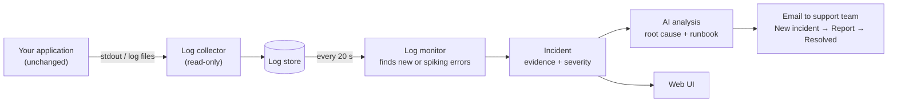
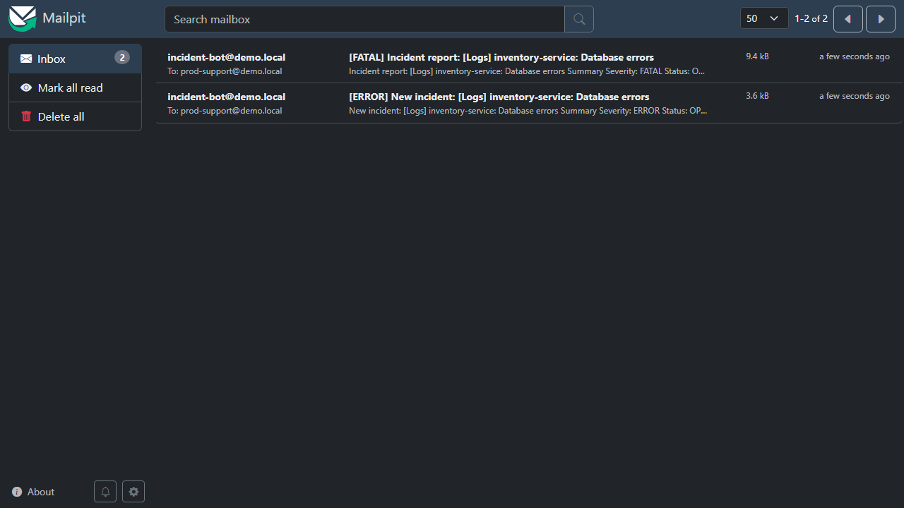
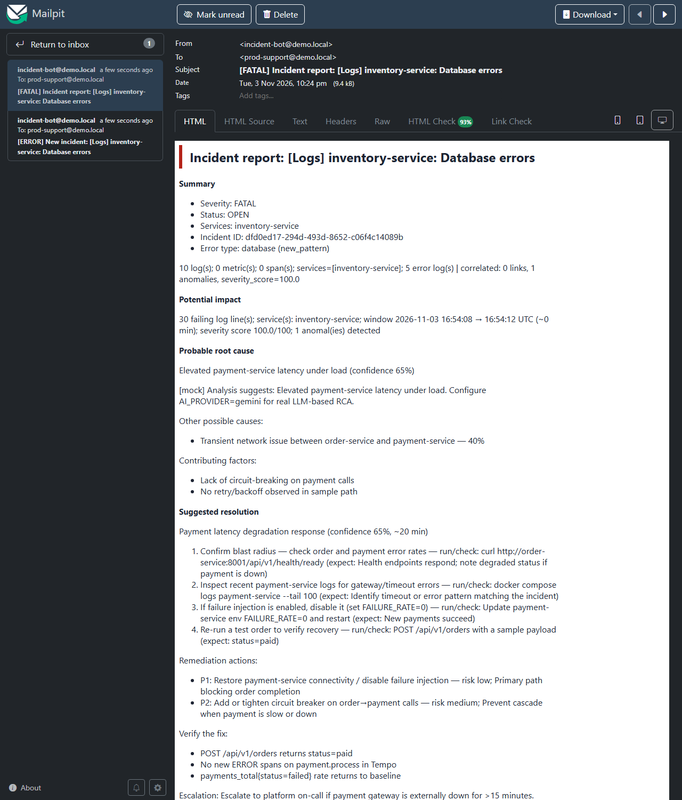
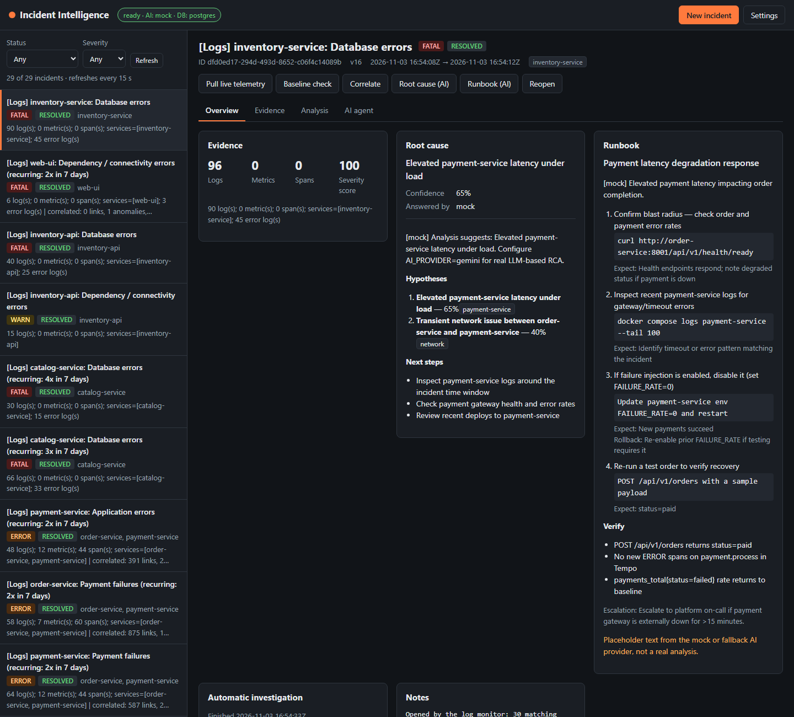
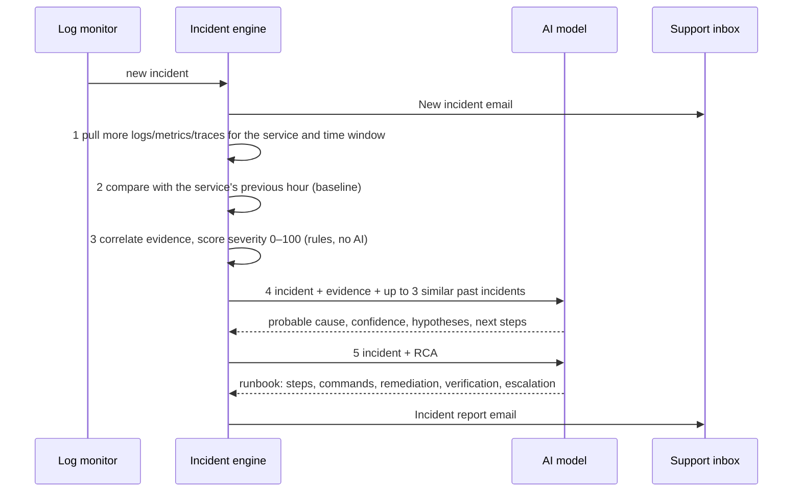

# Incident Intelligence: User Guide

This guide covers installing the tool, connecting your own applications,
seeing an incident detected, analyzed and emailed, and checking that it all
works.

It assumes no prior knowledge of the project. Every command and output below
comes from a real run on a Windows laptop with Docker Desktop (November 2026).
Outputs are shortened where marked `…`.

**Contents**

1. [What the tool does](#1-what-the-tool-does)
2. [Prerequisites](#2-prerequisites)
3. [Install and start](#3-install-and-start)
4. [Tutorial: connect a new application and get an incident report](#4-tutorial-connect-a-new-application-and-get-an-incident-report)
5. [Integrating your applications](#5-integrating-your-applications)
6. [Configuration](#6-configuration)
7. [How detection works](#7-how-detection-works)
8. [AI root-cause analysis and remediation](#8-ai-root-cause-analysis-and-remediation)
9. [Incident reports and email](#9-incident-reports-and-email)
10. [Working with incidents (UI and API)](#10-working-with-incidents-ui-and-api)
11. [Verify everything end to end](#11-verify-everything-end-to-end)
12. [Troubleshooting](#12-troubleshooting)
13. [Stop, reset, uninstall](#13-stop-reset-uninstall)
14. [FAQ](#14-faq)
15. [Glossary](#15-glossary)

---

## 1. What the tool does



1. Your application writes logs as it already does: to the console (stdout)
   or to files. **You don't change its code.**
2. A collector reads those logs **read-only** and stores them.
3. The log monitor looks at new log lines every 20 seconds. When an error
   pattern is new or suddenly much more frequent, it opens an **incident**.
4. The incident is investigated automatically:
   1. more evidence is gathered
   2. a rules engine scores severity
   3. an AI model writes the probable root cause and a step-by-step runbook
5. The production support team gets an email thread: **New incident**, then
   the **Incident report**, then **Resolved** once errors stop.

---

## 2. Prerequisites

| Need | Version / detail |
|---|---|
| Docker Desktop (Windows/macOS) or Docker Engine + Compose v2 (Linux) | Compose v2 (`docker compose …`); allocate **≥ 6 GB RAM** to Docker |
| Git | any |
| Python | 3.10+ (only for the validation script, standard library only) |
| Free ports | 3000, 3100, 3200, 4317, 4318, 5432, 8000–8002, 8025, 1025, 8080, 8090, 8889, 9090, 9093, 12345 |
| Disk | ~5 GB for images and data |
| Optional | An AI model: Ollama (free, local) or an API key for Gemini / Claude / OpenAI. Without one, a built-in mock is used (see §8) |

> **Port 5432 already in use?** If PostgreSQL is installed on your machine, it
> also listens on 5432. The stack still works (it talks to its own Postgres
> over the Docker network), but tools on your machine that connect to
> `localhost:5432` reach *your* Postgres, not the stack's.

---

## 3. Install and start

### 3.1 Get the code and create the env files

```bash
git clone <repository-url> incident-intelligence
cd incident-intelligence
git checkout enhancements/ai-platform

cp services/ai-service/.env.example      services/ai-service/.env
cp services/order-service/.env.example   services/order-service/.env
cp services/payment-service/.env.example services/payment-service/.env
```

You don't need to edit these files for a first run. The defaults use the
mock AI model and the local test inbox.

### 3.2 Start the platform

```bash
docker compose up -d --build        # first build takes a few minutes
```

Check that all 14 containers are running:

```bash
docker compose ps --format "{{.Service}}: {{.State}}"
```
```
ai-service: running        alertmanager: running   alloy: running
docker-proxy: running      grafana: running        loki: running
mailpit: running           order-service: running  otel-collector: running
payment-service: running   postgres: running       prometheus: running
tempo: running             web-ui: running
```

Check that the core service and the log monitor are up:

```bash
curl http://localhost:8000/api/v1/health/ready
```
```json
{"status":"ready","ai_provider":"mock","database":"postgres"}
```

```bash
curl http://localhost:8000/api/v1/log-monitor/status
```
```json
{"enabled": true, "running": true, "interval_seconds": 20, "runs": 3, "lines_scanned": 12, "last_error": null, …}
```

### 3.3 (Optional) start the demo applications

These are sample "third-party" apps in their own, separate compose project.
They're useful for trying the tool out:

```bash
docker compose -f demo-apps/docker-compose.yml up -d --build
```

### 3.4 What's where

| Open | URL | What it's for |
|---|---|---|
| **Test inbox** | http://localhost:8025 | Every email the tool sends (Mailpit) |
| **Incident UI** | http://localhost:8080 | Incidents, evidence, analysis, AI agent |
| API docs | http://localhost:8000/docs | Every endpoint, try them in the browser |
| Grafana | http://localhost:3000 (admin / admin) | Explore → Loki → `{source="docker"}` shows collected logs |
| Collector status | http://localhost:12345 | Alloy pipeline health |
| Demo app | http://localhost:8090/products | catalog-service (if started) |

---

## 4. Tutorial: connect a new application and get an incident report

In this tutorial you'll run an application that has **never been part of this
project**: a tiny Python service started with plain `docker run`, with no
compose file, no labels and no SDK. It logs normally for 30 seconds, then
loses its Redis cache for 60 seconds, then recovers. You'll watch the tool
detect the failure, analyze it, email the report, and close the incident.

### Step 1: Clear the test inbox

Open http://localhost:8025 and click **Delete all**, or:

```bash
curl -X DELETE http://localhost:8025/api/v1/messages
```

### Step 2: Start the application

```bash
# Git Bash on Windows: prefix with MSYS_NO_PATHCONV=1
docker run -d --name inventory-service -e FAIL_AFTER=30 -e FAIL_FOR=60 python:3.12-alpine python -u -c '
import os, time, random, datetime
t0 = time.time()
fail_after, fail_for = int(os.environ["FAIL_AFTER"]), int(os.environ["FAIL_FOR"])
while True:
    elapsed = time.time() - t0
    ts = datetime.datetime.now(datetime.timezone.utc).strftime("%Y-%m-%dT%H:%M:%S.%fZ")
    if fail_after <= elapsed < fail_after + fail_for:
        print(f"{ts} ERROR inventory-service: redis.exceptions.ConnectionError: Error 111 connecting to cache:6379. Connection refused. (sku=SKU-{random.randint(100, 999)})")
        print(f"{ts} WARN  inventory-service: GET /stock status=503 {random.randint(2, 9)}ms")
    else:
        print(f"{ts} INFO  inventory-service: GET /stock 200 {random.randint(2, 9)}ms")
    time.sleep(1)
'
```

That's the whole integration. You registered nothing and changed nothing in
the tool.

### Step 3: Confirm its logs are being collected

Within about 10 seconds the collector discovers the new container:

```bash
curl -G http://localhost:3100/loki/api/v1/series --data-urlencode 'match[]={service_name="inventory-service"}'
```
```json
{"status":"success","data":[{"service_name":"inventory-service","source":"docker"}]}
```

The service name comes from the container name.

### Step 4: Wait for the failure

After 30 seconds the app starts logging:

```
2026-11-03T16:54:08.734Z ERROR inventory-service: redis.exceptions.ConnectionError: Error 111 connecting to cache:6379. Connection refused. (sku=SKU-927)
2026-11-03T16:54:08.734Z WARN  inventory-service: GET /stock status=503 7ms
```

The monitor's next poll finds both lines. It turns them into two **patterns**
(numbers and IDs are replaced by `#` and `*`):

```bash
curl http://localhost:8000/api/v1/log-monitor/status
```
```json
"top_patterns": [
  {"service": "inventory-service", "error_class": "database", "total": 15, "first_seen": "2026-11-03T16:54:22Z",
   "template": "inventory-service: redis.exceptions.connectionerror: error # connecting to cache:#. connection refused. (sku=*"},
  {"service": "inventory-service", "error_class": "http_5xx", "total": 15,
   "template": "inventory-service: get /stock status=* #ms"}
]
```

The Redis error is classified as **database**. The 503 response is a
**symptom**, so it joins the database incident instead of opening a second
one.

### Step 5: Read the emails

About 25 seconds after the first error, two emails are in the inbox:



```
16:54:33  [ERROR] New incident: [Logs] inventory-service: Database errors
16:54:33  [FATAL] Incident report: [Logs] inventory-service: Database errors
```

The severity went from ERROR to FATAL because the investigation scored the
incident 100/100 (45 error lines in under a minute on one service). Open the
**Incident report**:



The full text of every email section is in [§9](#9-incident-reports-and-email).

> **About the root cause in this screenshot.** The tutorial runs with the
> built-in **mock** AI model. It answers from keywords and talks about
> "payment-service latency" even though this is a Redis outage, and the email
> says so in its NOTE section. With a real model (see §8) this section
> analyzes the actual evidence. The detection, grouping, severity, evidence
> and email flow are identical either way.

### Step 6: Look at the incident in the UI

Click **Open incident** in the email, or go to http://localhost:8080:



**What the UI shows:**
- **Overview:** evidence counts, severity score, root cause with hypotheses
  and next steps, the full runbook with commands, and which investigation
  steps ran
- **Evidence:** every collected log line on a timeline
- **Analysis:** anomalies, the baseline comparison, similar past incidents
- **AI agent:** ask a follow-up question and watch each step live

### Step 7: Recovery

After 60 seconds of errors the app is healthy again. When no matching errors
have appeared for the quiet period (3 minutes in the default compose setup),
the incident closes on its own and a third email arrives:

```
16:58:22  [FATAL] Resolved: [Logs] inventory-service: Database errors
```
```
RESOLUTION
Resolved at 2026-11-03T16:58:22Z.
Errors lasted about 1.0 minute(s).
No matching errors for 194 seconds before resolving.
```

### Step 8: Clean up

```bash
docker rm -f inventory-service
```

**What you saw:**
- a brand-new app was monitored with zero setup
- its failure was detected about 25 seconds after it started
- one incident was opened, with the cause and its symptoms grouped together
- an analyzed report was emailed
- the incident closed automatically after recovery

> **A real-world side effect from the same session:** while the tutorial
> was being recorded, ai-service was briefly restarted. The web UI's nginx
> logged `connection refused` errors for those seconds. The tool caught that
> too and opened *"[Logs] web-ui: Dependency / connectivity errors
> (recurring: 2x in 7 days)"*, then resolved it on its own. That's
> monitoring of the tool's own components with no extra setup.

---

## 5. Integrating your applications

### 5.1 Choose the method that matches how your app runs

| Your app… | What to do | App changes |
|---|---|---|
| runs in Docker on the same host (compose, `docker run`, any network) | **Nothing.** It is discovered automatically | none |
| writes log files | Make the files visible to the collector (see 5.3) | none |
| runs elsewhere and already ships logs (Fluent Bit, Vector, OTel, Promtail) | Point the shipper at Loki with two labels (see 5.4) | none (shipper config only) |

### 5.2 Docker containers

Docker apps are picked up automatically. The service name is the compose
**service** name, or the container name for `docker run`. Example compose
file for your own app; **nothing in it is specific to this tool**:

```yaml
# my-app/docker-compose.yml
services:
  orders-api:              # becomes service_name="orders-api"
    image: my-company/orders-api:2.4.1
    ports: ["9000:9000"]
```
```bash
docker compose -f my-app/docker-compose.yml up -d
```

**Limit what is watched (optional):**

```bash
# only these compose projects (regex); default ".*" watches every container
LOGMON_WATCH_PROJECTS="my-app|demo-apps" docker compose up -d alloy
```

```yaml
# exclude one container: add this label to it
    labels:
      logmon.ignore: "true"
```

To skip a service in detection but still collect its logs, set
`LOG_MONITOR_EXCLUDE_SERVICES=["noisy-service"]` on ai-service (see §6).

### 5.3 Log files

The collector tails every `*.log` file in `demo-apps/logs/` (mounted
read-only), and the file name becomes the service name:

```bash
echo "[$(date -u '+%Y-%m-%d %H:%M:%S,000')] ERROR Payment gateway rejected batch charge (invoice INV-1)" >> demo-apps/logs/legacy-billing.log
echo "[$(date -u '+%Y-%m-%d %H:%M:%S,000')] ERROR Payment gateway rejected batch charge (invoice INV-2)" >> demo-apps/logs/legacy-billing.log
```
→ result: `[ERROR] New incident: [Logs] legacy-billing: Payment failures`

To watch a different folder, add a read-only mount to the `alloy` service in
`docker-compose.yml` and a matching path in `observability/alloy/config.alloy`:

```yaml
  alloy:
    volumes:
      - /var/log/my-legacy-app:/var/log/watched/my-legacy-app:ro
```
```hcl
local.file_match "files" {
  path_targets = [
    {"__path__" = "/var/log/watched/*.log"},
    {"__path__" = "/var/log/watched/my-legacy-app/*.log"},
  ]
  sync_period = "10s"
}
```

The `loki.process "files"` block in `config.alloy` takes the service name
from the file name. Adjust its regex if your files are in sub-folders.
Restart with `docker compose up -d alloy`.

### 5.4 Existing log shippers

Any Loki-compatible shipper works. Send to
`http://<docker-host>:3100/loki/api/v1/push` with two labels:

| Label | Value |
|---|---|
| `source` | `docker` or `file` (the monitor reads `{source=~"docker|file"}`) |
| `service_name` | your service's name |

Example for Fluent Bit (not tested in this repo; check it against your
Fluent Bit version):

```ini
[OUTPUT]
    Name    loki
    Match   *
    Host    your-docker-host
    Port    3100
    Labels  source=docker, service_name=orders-api
```

### 5.5 Log format tips (optional, improves results)

The monitor reads both plain-text and JSON logs:

| Format | What it uses |
|---|---|
| Plain text | a level word (`ERROR`, `WARN`, `FATAL`, `INFO`…) near the start; a leading timestamp is stripped |
| JSON (one object per line) | `level` / `levelname` / `severity`, `message` / `msg` / `body`, `trace_id`, `exception` |

**Root-cause analysis gets better when each line has:**
- one event per line
- a request or trace ID
- the dependency involved: host, port or table

You don't need structured logging to get started.

---

## 6. Configuration

There are two places to configure:

| File | Used for |
|---|---|
| **`.env` in the repository root** (next to `docker-compose.yml`) | Email recipients, mail server, log-monitor timing. **Start here.** Copy `.env.example` |
| `services/ai-service/.env` | AI model and keys, detection thresholds, notification events, security |

After changing either one: `docker compose up -d ai-service`.

### 6.1 Email: who receives the reports

`.env` (repository root):

```bash
NOTIFY_EMAIL_TO=["prod-support@your-company.com","oncall@your-company.com"]
```

With only this set, emails still go to the **local test inbox**
(http://localhost:8025). Mailpit catches everything and never delivers
outside your machine.

### 6.2 Email: delivering to a real inbox

Add a real SMTP server to the same root `.env`. Gmail example (needs 2-Step
Verification; create an **App Password** under Google Account → Security →
App passwords):

```bash
NOTIFY_EMAIL_TO=["you@gmail.com"]
SMTP_HOST=smtp.gmail.com
SMTP_PORT=587
SMTP_STARTTLS=true
SMTP_USERNAME=you@gmail.com
SMTP_PASSWORD=abcdefghijklmnop          # the 16-character app password
NOTIFY_EMAIL_FROM=you@gmail.com
```

| Provider | `SMTP_HOST` | `SMTP_PORT` | Other |
|---|---|---|---|
| Gmail | smtp.gmail.com | 587 | `SMTP_STARTTLS=true`, app password |
| Microsoft 365 / Outlook | smtp.office365.com | 587 | `SMTP_STARTTLS=true` |
| Any provider with implicit TLS | your host | 465 | `SMTP_SSL=true` |
| Local test inbox (default) | mailpit | 1025 | nothing |

`.env` is git-ignored, so your password is never committed.

### 6.3 Which emails are sent

`services/ai-service/.env`:

```bash
NOTIFY_EMAIL_EVENTS=["incident_created","runbook_completed","incident_resolved"]   # default
NOTIFY_MIN_SEVERITY=WARN       # quieter incidents are not emailed
UI_BASE_URL=http://localhost:8080   # "Open incident" link (compose sets this)
```

| Event | Email | When |
|---|---|---|
| `incident_created` | New incident | as soon as an incident opens |
| `rca_completed` | Root cause identified | after RCA (off by default; the report includes it) |
| `runbook_completed` | **Incident report** | after the runbook: the full report |
| `incident_resolved` | Resolved | auto-resolve, Alertmanager resolve, or manual resolve |

Slack and generic webhooks can be added alongside email:
`NOTIFY_SLACK_WEBHOOK_URL`, `NOTIFY_WEBHOOK_URLS`, `NOTIFY_WEBHOOK_SECRET`.

### 6.4 Detection settings

| Setting | Default | Compose | Meaning |
|---|---|---|---|
| `LOG_MONITOR_ENABLED` | false | **true** | run the log monitor |
| `LOG_MONITOR_INTERVAL_SECONDS` | 30 | 20 | how often new log lines are checked |
| `LOG_MONITOR_NEW_PATTERN_MIN_COUNT` | 2 | | hits per poll for a never-seen error pattern (FATAL: 1) |
| `LOG_MONITOR_MIN_COUNT` | 3 | | a known pattern needs at least this many hits… |
| `LOG_MONITOR_Z_THRESHOLD` | 3.0 | | …and must be this far above its normal rate |
| `LOG_MONITOR_RESOLVE_AFTER_SECONDS` | 300 | 180 | quiet time before an incident auto-resolves |
| `LOG_MONITOR_RECURRING_DAYS` | 7 | | look-back for "recurring" |
| `LOG_MONITOR_EXCLUDE_SERVICES` | [] | | services to ignore |
| `LOG_MONITOR_INVESTIGATE` | true | | run AI analysis on new incidents |
| `LOG_MONITOR_QUERY` | `{source=~"docker\|file"}` | | which log streams to read |

Values marked "Compose" are set in `docker-compose.yml`. The interval and
resolve time can be overridden from the root `.env`
(`LOG_MONITOR_INTERVAL_SECONDS=…`, `LOG_MONITOR_RESOLVE_AFTER_SECONDS=…`).

### 6.5 AI model

See [§8.3](#83-turn-on-a-real-ai-model).

---

## 7. How detection works

```
new log lines ──► keep failures ──► make a pattern ──► classify ──► new or spiking? ──► group ──► incident
```

1. **Keep failures.** A line counts if any of these is true:
   - its level is ERROR or FATAL
   - it reports an HTTP 5xx response (`status=503`, `" 500`)
   - it's a WARN that says *failed / refused / timeout / denied…*
2. **Make a pattern.** Timestamps, IDs, hex values and numbers are removed,
   so these repeats become one pattern:
   - `Error 111 connecting to cache:6379 (sku=SKU-927)`
   - `Error 111 connecting to cache:6379 (sku=SKU-454)`
   - → `error # connecting to cache:#. (sku=*`
3. **Classify:** database, payment, timeout, http_5xx, auth, resource,
   dependency, crash, or application_error.
4. **Decide.** Open an incident when either is true:
   - **new pattern:** seen at least twice in one poll (once if FATAL)
   - **spike:** a known pattern with at least 3 hits and far above its own
     recent median (robust z-score ≥ 3)

   A single stray error doesn't open an incident.
5. **Group:**
   - One open incident per **service + error type**.
   - HTTP 5xx lines are symptoms and join the cause's incident.
   - New errors update the open incident instead of creating more.
   - The same group seen again within 7 days is marked
     **"(recurring: Nx in 7 days)"**.
6. **Resolve:** the incident closes after `LOG_MONITOR_RESOLVE_AFTER_SECONDS`
   with no matching errors.

**Two more ways incidents open:**
- **Prometheus alerts** reach the tool through Alertmanager (`POST
  /api/v1/alerts/alertmanager`).
- **Manually**, with `POST /api/v1/incidents` or the UI's **New incident**
  button.

---

## 8. AI root-cause analysis and remediation

### 8.1 What happens after an incident opens



The automatic-investigation card in the UI shows which steps ran (`enrich
ok, baseline ok, correlate ok, rca ok, runbook ok`). A failing step is
recorded and the rest still run.

### 8.2 Rules vs AI

| Done by rules (deterministic) | Done by the AI model |
|---|---|
| detecting and grouping errors, recurrence, severity score, anomalies, similar incidents | explaining the root cause, ranking hypotheses, writing the runbook and remediation steps |

The model runs **once per incident**, not per log line.

### 8.3 Turn on a real AI model

Edit `services/ai-service/.env`, then run `docker compose up -d ai-service`.

| Option | Cost | Settings |
|---|---|---|
| **Mock** (default) | free | `AI_PROVIDER=mock`: keyword-based placeholder text, clearly labelled in emails and the UI |
| **Ollama** (runs on your machine) | free | install Ollama, `ollama pull llama3.1`, then `AI_PROVIDER=ollama` and `OLLAMA_BASE_URL=http://host.docker.internal:11434/v1` |
| Gemini | free tier / paid | `AI_PROVIDER=gemini`, `GEMINI_API_KEY=…` |
| Claude | paid | `AI_PROVIDER=anthropic`, `ANTHROPIC_API_KEY=…` |
| OpenAI | paid | `AI_PROVIDER=openai`, `OPENAI_API_KEY=…` |

Check which model answered: `curl http://localhost:8000/api/v1/health/ready`
→ `"ai_provider"`. The report email also names the provider. If every
configured model fails, the tool falls back to the mock and the report says
so.

**Measure the model's quality.** There are 6 known incidents with expected
causes (a real model makes about 12 API calls):

```bash
cd services/ai-service && pip install -r requirements-dev.txt
python -m evals.run_evals
```

---

## 9. Incident reports and email

Each incident gets **one email thread**. Below is the real content from the
tutorial (plain-text part; the HTML part has the same sections).

**1. New incident**, sent immediately:

```
New incident: [Logs] inventory-service: Database errors

SUMMARY
- Severity: ERROR
- Status: OPEN
- Services: inventory-service
- Incident ID: dfd0ed17-294d-493d-8652-c06f4c14089b
- Error type: database (new_pattern)

POTENTIAL IMPACT
30 failing log line(s); service(s): inventory-service; window 2026-11-03 16:54:08 → …

FIRST ERROR
inventory-service: redis.exceptions.ConnectionError: Error 111 connecting to cache:6379. Connection refused. (sku=SKU-927)

NEXT
AI root-cause analysis and remediation steps are being prepared; the full incident report will follow in this thread.

Open incident: http://localhost:8080/#/incident/dfd0ed17-294d-493d-8652-c06f4c14089b
```

**2. Incident report**, after the analysis (mock model; sections shortened):

```
Incident report: [Logs] inventory-service: Database errors

SUMMARY            severity, status, services, error type, detection, recurrence
POTENTIAL IMPACT   30 failing log line(s); …; severity score 100.0/100; 1 anomal(ies) detected
PROBABLE ROOT CAUSE
  <cause> (confidence 65%)
  <AI summary>
  Other possible causes: …
  Contributing factors: …
SUGGESTED RESOLUTION
  <runbook title> (confidence 65%, ~20 min)
  1. <action> — run/check: <command> (expect: <result>)
  2. …
  Remediation actions:
  - P1: <action> — risk low; <why>
  - P2: …
  Verify the fix: …
  Escalation: …
KEY EVIDENCE
  16:54:08 ERROR inventory-service: … redis.exceptions.ConnectionError: Error 111 connecting to cache:6379 …
  16:54:08 WARN inventory-service: … GET /stock status=503 7ms
NOTE / ABOUT THIS REPORT
  which AI model produced it (and a placeholder warning for the mock or fallback)
Open incident: http://localhost:8080/#/incident/…
```

**3. Resolved**, after recovery:

```
RESOLUTION
Resolved at 2026-11-03T16:58:22Z.
Errors lasted about 1.0 minute(s).
No matching errors for 194 seconds before resolving.
Root cause identified during the incident: <cause>
```

**Safety:**
- Log content is HTML-escaped.
- Card numbers, JWTs, bearer tokens, `password=`/`token=`-style secrets and
  email addresses are **removed from emails** before sending.
- Raw logs are never attached.

---

## 10. Working with incidents (UI and API)

### 10.1 Web UI (http://localhost:8080)

**Incident list:**
- filters by status and severity
- refreshes every 15 s
- shows the "recurring" flag in titles

**Actions on an incident:**
- **Pull live telemetry**
- **Baseline check**
- **Correlate**
- **Root cause (AI)**
- **Runbook (AI)**
- **Resolve** / **Reopen**

**Tabs:** Overview, Evidence (timeline with filters), Analysis (anomalies,
baseline table, similar incidents), AI agent (live step-by-step
investigation).

**New incident:** run a demo failure scenario or open an empty incident.

### 10.2 API quick reference

Base URL `http://localhost:8000/api/v1`; full interactive docs at
http://localhost:8000/docs.

| Task | Command |
|---|---|
| List incidents (light) | `curl "$API/incidents/summaries?status=OPEN&limit=20"` |
| Get one incident | `curl $API/incidents/<id>` |
| Re-run analysis | `curl -X POST $API/incidents/<id>/rca` then `curl -X POST $API/incidents/<id>/runbook` |
| Similar past incidents | `curl $API/incidents/<id>/similar` |
| Resolve manually | `curl -X PATCH "$API/incidents/<id>/status?new_status=RESOLVED"` |
| Ask the agent (live steps) | `curl -N -X POST $API/agent/investigate/stream -H "Content-Type: application/json" -d '{"incident_id":"<id>","question":"Why is it failing?"}'` |
| Log monitor status | `curl $API/log-monitor/status` |
| Run a detection poll now | `curl -X POST "$API/log-monitor/run?wait=true"` |

(`API=http://localhost:8000/api/v1`)

### 10.3 How incidents close

| How | What happens |
|---|---|
| Errors stop | Auto-resolve after the quiet period → Resolved email |
| Alertmanager sends "resolved" | Alert-driven incidents close → Resolved email |
| A person clicks **Resolve** (or calls the API) | Closes now → Resolved email |

If the same failure comes back later, a **new** incident opens and is marked
recurring.

---

## 11. Verify everything end to end

### 11.1 Automated check against the running stack

```bash
python scripts/poc_demo.py            # 5 scenarios, ~7 min (includes the 3-min quiet period)
python scripts/poc_demo.py --quick    # detection + reports only, ~2 min
```

Real output (full run):

```
Preflight
  [PASS] ai-service ready
  [PASS] Mailpit
  [PASS] Loki
  [PASS] catalog-service (independent app)
  [PASS] log monitor running

1. Independent app (container stdout): catalog-service database down
  [PASS] incident detected + 'New incident' email - [ERROR] New incident: [Logs] catalog-service: Database errors
  [PASS] 'Incident report' email (RCA + remediation)
  [PASS] report has Probable Root Cause / Suggested Resolution / Potential Impact / Key Evidence
  [PASS] only one catalog incident (5xx symptoms merged)
2. Independent app (log file): legacy-billing.log
  [PASS] file-based app detected + email
3. Our own project (container stdout): payment-service failures
  [PASS] own-project failure detected + email
4. Recovery: errors stop -> auto-resolve
  [PASS] auto-resolved + 'Resolved' email
5. Recurrence: same failure again
  [PASS] recurring pattern flagged
  [PASS] recurrence count increased - 2 -> 3

17/17 checks passed.
```

It exits with 0 when everything passes, so you can use it in scripts.

### 11.2 Unit and integration tests (no Docker needed)

```bash
cd services/ai-service
python -m venv .venv && . .venv/bin/activate      # Windows: .venv\Scripts\activate
pip install -r requirements-dev.txt
pytest -q
```

### 11.3 Manual checklist

- [ ] `curl localhost:8000/api/v1/health/ready` → `"status":"ready"`
- [ ] `curl localhost:8000/api/v1/log-monitor/status` → `"running": true`, `"last_error": null`
- [ ] Grafana Explore → Loki → `{service_name="<your-app>"}` shows your logs
- [ ] An error burst in your app → *New incident* email within ~1 minute
- [ ] *Incident report* email follows (seconds with mock, longer with a real model)
- [ ] After errors stop → *Resolved* email after the quiet period

---

## 12. Troubleshooting

| Symptom | Likely cause | Fix |
|---|---|---|
| `docker compose up` fails: "port is already allocated" | another program uses that port | stop it, or change the left side of the port mapping (e.g. `"18025:8025"`) |
| `/health/ready` → `"database":"error"` | Postgres not ready yet | wait 10 s; `docker compose logs postgres` |
| Log monitor status: `"running": false` | `LOG_MONITOR_ENABLED` not true | it is set in compose; check `docker compose config \| grep LOG_MONITOR` |
| Status shows `last_error` | Loki unreachable | `docker compose ps loki`; `curl localhost:3100/ready` |
| My app's logs aren't in Loki | not discovered or excluded | http://localhost:12345 (collector status); is it labelled `logmon.ignore=true`? outside `LOGMON_WATCH_PROJECTS`? `docker compose logs alloy` |
| Collector logs `403 Forbidden` | the Docker proxy blocks an endpoint | compose allows the container and network endpoints; add the needed one (GET only) to `docker-proxy` |
| Collector logs `timestamp too old` once | old history of an existing container | harmless: Loki rejects lines older than 7 days |
| Errors in logs but no incident | below thresholds, or the service is excluded | need ≥ 2 matching lines in one poll; check `top_patterns` in the status; lower `LOG_MONITOR_NEW_PATTERN_MIN_COUNT` |
| Every error updates one old incident | intended while it's open | it auto-resolves after the quiet period, or resolve it in the UI |
| Unrelated containers create incidents | everything on the host is watched | set `LOGMON_WATCH_PROJECTS` or add `logmon.ignore=true` |
| No email at all | severity below `NOTIFY_MIN_SEVERITY`, or SMTP error | `docker compose logs ai-service \| grep -i email`; `curl localhost:8000/metrics \| grep notifications` |
| Gmail: `535 Username and Password not accepted` | normal password used | use an App Password (needs 2-Step Verification) |
| Email in Mailpit but not in my real inbox | SMTP still points at Mailpit | set `SMTP_HOST` etc. in the **root** `.env` (§6.2), then `docker compose up -d ai-service` |
| Report says "placeholder" | mock AI model | configure a real model (§8.3) |
| UI shows "ai-service is not reachable" | ai-service restarting | wait a few seconds; the UI reconnects on its own |
| Things are slow / containers restart | not enough memory for Docker | give Docker ≥ 6 GB RAM |

**Useful commands:**

```bash
docker compose logs -f ai-service          # incidents, investigations, emails (JSON lines)
docker compose logs -f alloy               # log collection
curl localhost:8000/api/v1/log-monitor/status
curl -X POST "localhost:8000/api/v1/log-monitor/run?wait=true"   # run a detection poll now
```

---

## 13. Stop, reset, uninstall

```bash
docker compose -f demo-apps/docker-compose.yml down     # demo apps
docker compose down                                      # platform (keeps data)
docker compose down -v                                   # platform + all stored incidents, logs, metrics
```

---

## 14. FAQ

**Does it change or slow down my application?**
No. It reads logs after your app has written them, through a read-only path.
It never calls your app or touches its code, configuration or database.

**How does it get read-only access to Docker?**
Through `docker-proxy`, which only allows GET requests (list containers, read
logs). It can't start, stop or exec into anything. Log folders are mounted
`:ro`.

**How fast is detection?**
About 20–40 seconds after the errors start with the default 20-second
interval (25 s in the tutorial).

**Will I get an email for every error?**
No. You get one thread per incident: New → Report → Resolved. Repeats update
the open incident.

**Does it work without an AI key?**
Yes. Everything works with the mock model, but its root-cause text is
placeholder. Use Ollama for a free real model.

**Where is the data?**
In Docker volumes on your machine: Postgres (incidents), Loki (logs),
Prometheus (metrics). Nothing leaves your machine unless you configure a
cloud AI model or a real mail server.

**Can it monitor Kubernetes?**
Not in this version. The same collector (Alloy) can run as a Kubernetes
DaemonSet; that's on the roadmap.

**What isn't redacted?**
Emails are redacted. Logs stored in Loki and the evidence sent to the AI
model are not yet; keep that in mind before using a cloud AI model on
sensitive logs.

---

## 15. Glossary

| Term | Meaning |
|---|---|
| **Incident** | One problem on one service (service + error type), with its evidence, analysis and status |
| **Pattern / template** | An error message with IDs and numbers removed, so repeats count as one |
| **New pattern / spike** | The two reasons an incident opens: a never-seen error, or a known one far above its normal rate |
| **Recurring** | The same service + error type had an incident within the last 7 days |
| **RCA** | Root-cause analysis: the AI's probable cause, confidence and alternatives |
| **Runbook** | Ordered steps to diagnose and fix, with commands, expected results, rollback and verification |
| **Severity score** | 0–100, computed by rules from error volume, anomalies, services affected and declared severity |
| **Quiet period** | Time without matching errors before an incident auto-resolves |
| **Mailpit** | Free local email server and web inbox used for testing |
| **Loki / Alloy** | The log store and the log collector |

---

**More detail:**
- [POC_GUIDE.md](POC_GUIDE.md): how the POC is built
- [SYSTEM_FLOW.md](SYSTEM_FLOW.md): code-level flow, every endpoint and data field
- `services/ai-service/README.md`: service internals
